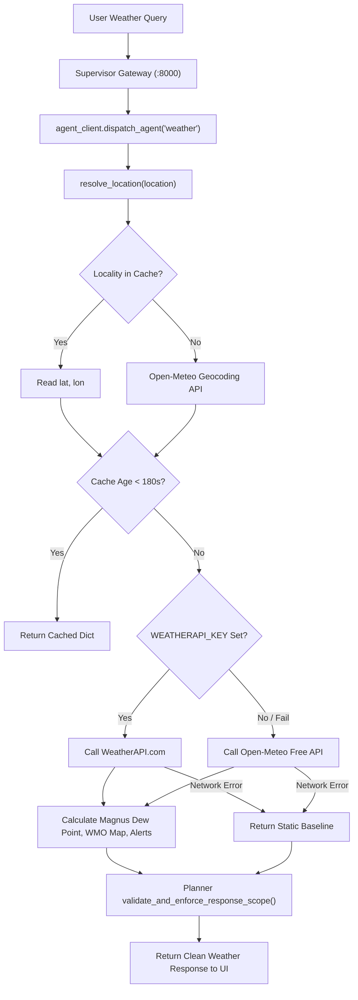
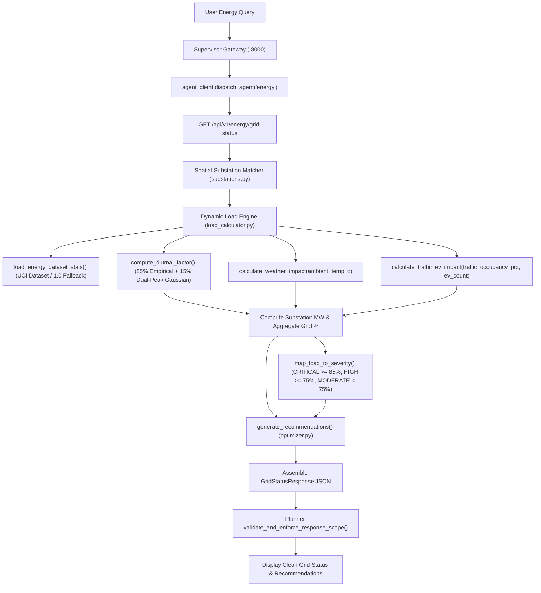

# SUPADSP — Smart Urban Planning & AI Decision Support Platform

> Enterprise-grade AI-powered decision support platform for municipal urban planning and smart governance in Hyderabad.

[](https://opensource.org/licenses/MIT)
[]()
[]()
[]()

---

## Overview

**SUPADSP** (Smart Urban Planning and Decision Support Platform) enables municipal planners and government administrators to monitor real-time city telemetry, forecast future conditions, simulate interventions, and receive grounded, actionable recommendations across four core intelligence domains:

- **Traffic Intelligence** — Micro-simulation via Eclipse SUMO, corridor flow analysis, congestion prediction, and adaptive signal timing optimization.
- **Pollution Intelligence** — Live air quality ingestion across 13 Hyderabad CAAQMS stations via WeatherAPI telemetry, CPCB NAQI calculation engine, Spatial-Temporal GRU forecasting model, and statutory CPCB/NCAP mitigation playbook reasoning.
- **Weather Intelligence** — Live meteorological telemetry and atmospheric forecasts via accurate WeatherAPI integration, monitoring temperature, humidity, wind vectors, precipitation, and environmental dispersion parameters.
- **Energy Intelligence** — Grid load monitoring, peak shaving analysis, substation load distribution, and battery energy storage simulation.

The platform coordinates specialist domain agents through an autonomous **Planner AI Agent** and **Supervisor API Gateway**, providing natural language decision support with verifiable grounding and deterministic statutory playbook fallbacks.

---

## Key Features

1. **Autonomous Planning AI Assistant**
   - Natural-language interface at `/api/planning/chat` and `/agents/planner/execute`.
   - Domain router supporting traffic, pollution, weather, energy, and multi-domain queries.
   - LLM-powered multi-stage planning and causal analysis with `<think>` tag stripping and strict token controls.
   - Deterministic rule-based fallback grounded in verified statutory mitigation playbooks (CPCB, MoEFCC, NCAP).

2. **Accurate Weather Agent**
   - Live weather telemetry fetching ambient temperature, relative humidity, barometric pressure, wind vectors, and precipitation.
   - Hourly and 7-day weather forecasting using accurate external API telemetry.
   - Atmospheric dispersion context for pollution modeling and weather-traffic correlation analysis.

3. **Grounded Pollution Engine**
   - CPCB breakpoint interpolation engine (PM2.5, PM10, NO2, SO2, CO, O3, NH3) with zero arithmetic hallucination.
   - Live telemetry ingestion from 13 Telangana monitoring stations (Bollaram, Sanathnagar, Zoo Park, ECIL Kapra, etc.).
   - Spatial-Temporal GRU forecaster with KNN covariate modeling.
   - 14-day zero-gap accumulation rule before transitioning from verified historical archive to live-trained forecasts.

4. **Traffic Simulation Loop**
   - SUMO microsimulation for corridor bottlenecks (Narayanguda, Begumpet, Jubilee Hills).
   - Realism audit validating speed, flow, density, and queue length conventions.

5. **Energy Grid Intelligence**
   - 15-node TSSPDCL metropolitan electrical grid model across 6 municipal zones.
   - Hybrid Diurnal Load Ensemble model blending 85% empirical historical time-series distribution with an urban dual-peak Gaussian physics curve.
   - Cross-domain thermodynamic heatwave amplification and traffic-induced EV charging surge coupling.
   - Deterministic severity mapping and algorithmic 6-strategy peak-shaving dispatch engine.

---

## Architecture

```
┌────────────────────────────────────────────────────────────────────────────────────────────────────────────────────────┐
│                                              FRONTEND (React 18 + Vite)                                                │
│   Pages: Dashboard, Planning, Traffic, Weather, Pollution, Energy, Simulation                                          │
│   MapLibre GL JS · Recharts · Lucide Icons · TailwindCSS / CSS3                                                        │
└───────────────────────────────────────────┬────────────────────────────────────────────────────────────────────────────┘
                                            │ HTTP / JSON
                                            ▼
┌────────────────────────────────────────────────────────────────────────────────────────────────────────────────────────┐
│                                       SUPERVISOR API GATEWAY (FastAPI :8000)                                           │
│                                                                                                                        │
│   Routes:                                                                                                              │
│   ├── /api/planning/chat         → Planning AI Chat (Domain Router & Multi-Stage Planner)                              │
│   ├── /agents/planner/execute    → Autonomous Multi-Domain Dispatch & Synthesis                                        │
│   ├── /api/pollution/*           → Specialist Agent - Pollution (Port 8002)                                            │
│   ├── /api/v1/weather/*          → Specialist Agent - Weather (In-Process / HTTP)                                      │
│   ├── /api/v1/traffic/*          → Specialist Agent - Traffic (In-Process / HTTP)                                      │
│   ├── /api/v1/energy/*           → Specialist Agent - Energy (In-Process / HTTP)                                        │
│   └── /api/v1/simulation/*       → Specialist Agent - Simulation (In-Process / HTTP)                                   │
└───────────────────────────────────────────┬────────────────────────────────────────────────────────────────────────────┘
                                            │
    ┌─────────────────────────┬─────────────┼───────────────┬────────────────────────┐
    ▼                         ▼             ▼               ▼                        ▼
┌──────────────────┐ ┌────────────────┐ ┌───────────────┐ ┌────────────────┐ ┌───────────────────┐
│ POLLUTION AGENT  │ │ WEATHER AGENT  │ │ TRAFFIC AGENT │ │  ENERGY AGENT  │ │ SIMULATION AGENT  │
│ Port: 8002       │ │ Dual-API Sync  │ │ SUMO Runner   │ │ Diurnal Model  │ │ TraCI Controller  │
│ • CPCB Engine    │ │ • WeatherAPI   │ │ • Bottlenecks │ │ • 15 TSSPDCL   │ │ • Signal Timing   │
│ • GRU Forecaster │ │ • Open-Meteo   │ │ • Corridors   │ │   Substations  │ │ • Rerouting       │
│ • 13 CAAQMS Stns │ │ • 7-Day / 24h  │ │ • Speed / Del │ │ • Heatwave / EV│ │ • Baseline Delta  │
│ • Statutory Play │ │ • Pavement Drag│ │ • Demand Gen  │ │ • Peak Shaving │ │ • Micro-Metrics   │
└──────────────────┘ └────────────────┘ └───────────────┘ └────────────────┘ └───────────────────┘
```

---

## Project Structure

```
SmartCity/
├── frontend/                     # React 18 + Vite dashboard application
│   ├── src/pages/                # Dashboard, Planning, Pollution, Weather, Traffic, Energy
│   ├── src/components/           # Charts, maps, gauges, problem solver UI
│   └── src/services/             # API client services & telemetry fetchers
├── backend/
│   ├── supervisor/               # FastAPI Supervisor Gateway & Agent Dispatcher
│   ├── agents/
│   │   ├── planner_agent/        # Autonomous LLM Planner & contract enforcement
│   │   ├── pollution_agent/      # CPCB engine, GRU forecaster, live WeatherAPI client
│   │   ├── weather_agent/        # Accurate WeatherAPI telemetry & forecast provider
│   │   ├── traffic_agent/        # SUMO traffic integration & demand generator
│   │   ├── energy_agent/         # Grid load & power peak analytics
│   │   └── simulation_agent/     # SUMO simulation orchestrator & runners
├── simulations/                  # SUMO road networks, OSM data, configuration files
├── tests/                        # Comprehensive pytest test suites (grounding, contracts, SUMO)
├── eval/                         # Golden evaluation sets & baseline benchmarks
├── scripts/                      # Startup, reproduction, evaluation, and smoke-test utilities
└── docs/                         # Architecture audit, route specifications, API inventory
```

---

## Weather Agent — Technical Specification & Implementation

### 1. Purpose & Responsibilities
The **Weather Agent** (`backend/agents/weather_agent/`) is a specialist microservice in the SUPADSP decision support platform. It acts as the real-time meteorological telemetry authority for the Greater Hyderabad metropolitan area, responsible for:
- Continuous ambient meteorological observation ingestion across urban corridors (temperature, humidity, wind vectors, pressure, precipitation, dew point, UV index, visibility).
- Dual-source live telemetry synchronization with multi-tier fallback (WeatherAPI.com primary, Open-Meteo secondary, offline verified baseline).
- Numerical weather forecasting providing 24-hour hourly projections and 7-day daily synoptic outlooks.
- Severe weather risk assessment and threshold-based alerting (heatwaves, convective thunderstorms, cloudburst inundation, high winds).
- Biometeorological air comfort, outdoor activity advisories, and pollen/asthma vulnerability indices.
- Cross-domain coupling calculations providing physical impact coefficients to the **Traffic Agent** (pavement friction loss, stormwater drainage risk), the **Energy Agent** (HVAC cooling surge factor), and the **Pollution Agent** (atmospheric stability, advective dispersion).
- Conversational question-answering over local meteorological telemetry (`/api/v1/weather/chat`).
- Contract-compliant evidence provisioning to the **Planner AI Agent**.

### 2. Architecture & Schemas
- **Entry Point**: `backend.agents.weather_agent.main:app` (FastAPI v2.1.0).
- **Dependencies**: `fastapi`, `pydantic` (v2), `urllib` (Python standard library — zero heavy external HTTP libraries needed).
- **Internal Modules**:
  - [`main.py`](file:///b:/Coding/SDC-II/SmartCity/backend/agents/weather_agent/main.py): FastAPI app, route controllers, cross-domain impact analysis (`/api/v1/weather/analyze`).
  - [`provider.py`](file:///b:/Coding/SDC-II/SmartCity/backend/agents/weather_agent/provider.py): `WeatherProvider` singleton, 180s in-memory cache, Open-Meteo & WeatherAPI clients, geocoding registry.
  - [`schemas.py`](file:///b:/Coding/SDC-II/SmartCity/backend/agents/weather_agent/schemas.py): Pydantic contracts (`WeatherCurrentResponse`, `WeatherForecastResponse`, etc.).
  - [`alerts.py`](file:///b:/Coding/SDC-II/SmartCity/backend/agents/weather_agent/alerts.py): Severe alert thresholding and biometeorological air comfort calculations.
  - [`chat.py`](file:///b:/Coding/SDC-II/SmartCity/backend/agents/weather_agent/chat.py): Locality extraction and rule-based conversational reasoning engine.
- **REST API Endpoints**:
  - `GET /health`: Health probe reporting status (`ONLINE`), active provider, `is_live` boolean, and UTC timestamp.
  - `GET /api/v1/weather/current`: Query parameters: `location` (default `"Hyderabad"`), `city`. Returns `WeatherCurrentResponse`.
  - `GET /api/v1/weather/forecast`: Query parameters: `location`. Returns `forecast_7d`, `hourly`, and `weekly_precipitation`.
  - `GET /api/v1/weather/alerts`: Query parameters: `location`. Returns active meteorological alerts, primary risk, probability, and air comfort indices.
  - `POST /api/v1/weather/analyze`: Request body: `WeatherAnalyzeRequest`. Returns `WeatherAnalyzeResponse` containing current weather, cross-domain impacts, and municipal recommendations.
  - `POST /api/v1/weather/chat`: Request body: `{"question": "...", "location": "..."}`. Returns natural-language answer grounded in live telemetry.

### 3. Data Sources, APIs & Coverage
- **Live APIs**:
  1. **WeatherAPI.com** (`https://api.weatherapi.com/v1/forecast.json?key={KEY}&q={lat},{lon}&days=7&aqi=no&alerts=yes`): Primary live telemetry source when `WEATHERAPI_KEY` is present.
  2. **Open-Meteo REST API** (`https://api.open-meteo.com/v1/forecast`): 100% free, keyless global numerical weather prediction API. Fetches `temperature_2m`, `relative_humidity_2m`, `apparent_temperature`, `precipitation`, `weather_code`, `wind_speed_10m`, `wind_direction_10m`, `surface_pressure`, `uv_index`, `visibility`, 7-day daily arrays, and 24-hour hourly arrays.
  3. **Open-Meteo Geocoding API** (`https://geocoding-api.open-meteo.com/v1/search?name={name}&count=1`): Keyless dynamic geocoding resolving any city, area, or locality query to exact latitude and longitude.
- **Pre-warmed Spatial Registry**: 30 Hyderabad localities cached in `provider.LOCALITY_COORDINATES` for zero-latency lookup (Narayanguda, Begumpet, Gachibowli, HITEC City, Jubilee Hills, Banjara Hills, Secunderabad, Charminar, Sanathnagar, Nacharam, Bollaram, Patancheru, Tarnaka, Somajiguda, Kompally, Malakpet, Kukatpally, Madhapur, Miyapur, Ameerpet, Kondapur, Dilsukhnagar, LB Nagar, Shamshabad, Alwal, Uppal, Lingampally, Mehdipatnam, Koti, Hyderabad).
- **Offline Verified Baseline**: Deterministic seasonal baseline in `_get_baseline_fallback()` strictly used if network connectivity is down.
- **Historical Data**: The Weather Agent does not query historical weather archives (historical data is used in the Pollution and Energy agents).

### 4. Weather Variables Retrieved & Computed
1. `temperature_c`: Ambient 2m dry-bulb temperature ($^\circ\text{C}$).
2. `humidity_pct`: Relative humidity percentage ($0\text{--}100\%$).
3. `feels_like_c`: Apparent temperature factoring humidity and wind chill ($^\circ\text{C}$).
4. `precipitation_mm`: Liquid precipitation accumulation ($\text{mm}$).
5. `wind_speed_kmh`: 10m wind velocity ($\text{km/h}$).
6. `wind_direction`: 16-point cardinal compass direction (e.g., `WSW`, `ENE`).
7. `pressure_hpa`: Surface barometric pressure ($\text{hPa}$).
8. `dew_point_c`: Dew point temperature ($^\circ\text{C}$) computed via the Magnus formula.
9. `uv_index`: Ultraviolet index rating ($0\text{--}12+$).
10. `visibility_km`: Surface horizontal visibility ($\text{km}$).
11. `condition` & `icon`: Weather description (e.g., `Partly Cloudy`) and Lucide icon token.

### 5. Machine Learning Models: What Is Actually Implemented?
- **NO ML/DL Model Is Trained or Executed**: The Weather Agent does not use neural networks, random forests, or regression models.
- **NWP Forecast Ingestion**: Numerical forecasts originate from external NWP models (ECMWF, GFS, ICON) executed by Open-Meteo/WeatherAPI.
- **Deterministic Formulations Implemented**:
  - **Magnus-Tetens Dew Point Equation**:
    $$\alpha = \frac{17.27 \cdot T}{237.7 + T} + \ln\left(\frac{\max(\text{RH}, 1)}{100}\right), \quad T_{\text{dew}} = \frac{237.7 \cdot \alpha}{17.27 - \alpha}$$
  - **Wind Cardinal Conversion**:
    $$\text{idx} = \left\lfloor \frac{\text{deg} + 11.25}{22.5} \right\rfloor \pmod{16}$$
  - **WMO Code Mapping**: Translates WMO codes $0\text{--}99$ to standard condition labels and UI icons.
  - **Severe Alert Thresholds**:
    - Heatwave: $\ge 40^\circ\text{C}$ `CRITICAL`, $\ge 35^\circ\text{C}$ `MODERATE`.
    - Thunderstorm: Rain probability $\ge 60\%$ or precipitation $> 15\text{ mm}$ `HIGH`.
    - High Wind: Wind speed $\ge 35\text{ km/h}$ `MODERATE`.
  - **Cross-Domain Impact Multipliers**:
    - Traffic Speed Drop: $-15\%$ if precip $> 5\text{ mm}$, $-8\%$ if $0 < \text{precip} \le 5\text{ mm}$.
    - Pavement Friction: `LOW` if precip $> 2\text{ mm}$, else `NORMAL`.
    - HVAC Cooling Factor: $1.0 + \max(0.0, (T - 25.0) \cdot 0.04)$.
    - Pollutant Dispersion: `POOR` if wind $< 5\text{ km/h}$, `FAVORABLE` if wind $> 15\text{ km/h}$.

### 6. Caching & Fault Tolerance
- **In-Memory Cache**: 180-second TTL keyed by `f"{lat:.4f}_{lon:.4f}"`.
- **Fault-Tolerant Cascading**: WeatherAPI $\rightarrow$ Open-Meteo $\rightarrow$ Static Baseline.

### 7. End-to-End Execution Flow (Mermaid)



### 8. Realistic Request and Response

#### Request:
`GET /api/v1/weather/current?location=Narayanguda,%20Hyderabad`

#### Response:
```json
{
  "source": "Live Open-Meteo API (High-Accuracy Real-Time Telemetry)",
  "provider": "Open-Meteo",
  "is_live": true,
  "timestamp": "2026-10-12T14:30:00Z",
  "city": "Narayanguda",
  "latitude": 17.398,
  "longitude": 78.49,
  "temperature_c": 29.4,
  "humidity_pct": 52,
  "wind_speed_kmh": 11.2,
  "wind_direction": "WSW",
  "precipitation_mm": 0.0,
  "condition": "Mainly Clear",
  "icon": "Sun",
  "feels_like_c": 31.6,
  "dew_point_c": 18.5,
  "pressure_hpa": 1011.8,
  "visibility_km": 10.0,
  "uv_index": 5.4,
  "forecast_7d": [
    {
      "day": "Today",
      "date": "2026-10-12",
      "high": 33,
      "low": 23,
      "condition": "Mainly Clear",
      "rain": "10%",
      "icon": "Sun",
      "max_wind_kmh": 14.5,
      "precipitation_mm": 0.0
    }
  ],
  "hourly_temp": [
    {
      "h": "14:00",
      "time": "14:00",
      "temp": 29.4,
      "humidity": 52,
      "pressure": 1011.8,
      "rain_chance": 10,
      "wind_kmh": 11.2
    }
  ],
  "correlations": [
    {
      "param": "Temperature → AQI",
      "correlation": "+0.72",
      "direction": "up",
      "insight": "Ambient temp (29.4°C) accelerates photochemical oxidant synthesis"
    }
  ]
}
```

---

## Energy Agent — Technical Specification & Implementation

### 1. Purpose & Responsibilities
The **Energy Agent** (`backend/agents/energy_agent/`) is a specialist microservice in SUPADSP dedicated to electrical distribution grid monitoring, load modeling, peak shaving, and cross-domain optimization across the Hyderabad metropolitan region (TSSPDCL / TSTRANSCO electrical network).
- Continuous telemetry modeling across 15 primary 220kV and 132kV transmission and distribution substations spanning 6 municipal zones (HITECH City, Gachibowli, Secunderabad, Kukatpally, Old City, LB Nagar).
- Hybrid diurnal load modeling combining empirical historical weights derived from the UCI power consumption dataset with an urban dual-peak Gaussian physics model.
- Dynamic cross-domain coupling factoring live thermodynamic heatwave multipliers from the **Weather Agent** and EV fast-charging demand surges from the **Traffic Agent**.
- Deterministic grid stress categorization mapping load percentages to severity levels (`CRITICAL`, `HIGH`, `MODERATE`).
- Algorithmic peak shaving and synthesis of 6 prioritized demand-response, BESS battery storage, solar microgrid, and LED lighting dimming actions (`optimizer.py`).
- Serving structured electrical grid evidence to the **Planner AI Agent**.

### 2. Architecture & Schemas
- **Entry Point**: `backend.agents.energy_agent.main:app` (FastAPI v2.0.0).
- **Dependencies**: `fastapi`, `pydantic`, `pandas`, `numpy`, `math`.
- **Internal Modules**:
  - [`main.py`](file:///b:/Coding/SDC-II/SmartCity/backend/agents/energy_agent/main.py): FastAPI app, primary contract endpoints (`/api/v1/energy/grid-status`, `/analyze`, `/peak-shave`, `/substations`, `/zones`).
  - [`load_calculator.py`](file:///b:/Coding/SDC-II/SmartCity/backend/agents/energy_agent/load_calculator.py): Core telemetry engine, diurnal blending, weather/traffic multipliers, solar zenith curves, severity mapping.
  - [`substations.py`](file:///b:/Coding/SDC-II/SmartCity/backend/agents/energy_agent/substations.py): 15-node TSSPDCL substation registry, coordinates, voltages, capacities, and spatial matcher.
  - [`dataset_loader.py`](file:///b:/Coding/SDC-II/SmartCity/backend/agents/energy_agent/dataset_loader.py): Empirical historical time-series aggregator for UCI `household_power_consumption.txt` with graceful fallback.
  - [`optimizer.py`](file:///b:/Coding/SDC-II/SmartCity/backend/agents/energy_agent/optimizer.py): 6-strategy recommendation generator and algorithmic peak-shaving dispatch solver.
  - [`schema.py`](file:///b:/Coding/SDC-II/SmartCity/backend/agents/energy_agent/schema.py): Pydantic contracts (`GridStatusResponse`, `SubstationData`, `PeakShavingResponse`, etc.).
- **REST API Endpoints**:
  - `GET /health`: Health probe returning `{"agent": "Energy Agent", "status": "ONLINE"}`.
  - `GET /api/v1/energy/grid-status`: Primary contract endpoint. Query params: `location`, `ambient_temp_c`, `traffic_occupancy_pct`, `ev_count`. Returns `GridStatusResponse`.
  - `POST /api/v1/energy/analyze`: Scenario stability analysis. Request: `EnergyAnalyzeRequest`. Returns `EnergyAnalyzeResponse`.
  - `POST /api/v1/energy/peak-shave`: Peak shaving optimizer. Request: `PeakShavingRequest`. Returns `PeakShavingResponse`.
  - `GET /api/v1/energy/substations`: Query params: `zone`, `status`. Returns `List[SubstationData]`.
  - `GET /api/v1/energy/zones`: Returns aggregated zone consumption metrics (`List[ZoneConsumption]`).

### 3. Datasets, Calibration & Missing-Data Handling
- **Historical Benchmark Dataset**: UCI Machine Learning Repository — *Individual Household Electric Power Consumption*.
  - File Path: `datasets/raw/energy/household_power_consumption.txt` (candidate paths in `dataset_loader.py`).
  - Columns Ingested: `Date`, `Time`, `Global_active_power` (active power in kW), `Voltage` (in V).
  - Preprocessing: Reads sample records (`sample_rows=150000`), drops rows with null active power or time, extracts hour (`0..23`), calculates hourly mean active power, divides by grand mean to produce normalized hourly weight factors $W_{\text{Empirical}}(h)$ centered at 1.0.
  - Summary Stats: Baseline mean power $\approx 1.091\text{ kW}$ (std dev: $1.057\text{ kW}$, 98th percentile peak: $4.8\text{ kW}$, voltage mean: $240.8\text{ V}$).
- **Missing-Data & Fallback Handling**:
  - If `household_power_consumption.txt` is absent (as in lightweight repository clones), `dataset_loader.py` logs a warning and returns a neutral fallback profile of `1.0` across all 24 hours. The continuous multi-Gaussian urban physics curve in `load_calculator.py` then drives diurnal dynamics without throwing runtime exceptions.

### 4. Forecasting Algorithms & Mathematical Modeling
> **Important for Viva**: The Energy Agent **does NOT use neural networks or scikit-learn regressors**. It implements a **Hybrid Diurnal Load Ensemble Model** combining empirical statistical time-series distributions with physical thermodynamic and urban behavioral curves.

#### 1. Hybrid Diurnal Load Ensemble Model
$$W_{\text{Diurnal}}(t) = 0.85 \cdot W_{\text{Empirical}}(h) + 0.15 \cdot \left[ 0.82 + 0.22 e^{-\frac{(t-14)^2}{8}} + 0.18 e^{-\frac{(t-20)^2}{6}} + 0.12 e^{-\frac{(t-10.5)^2}{5}} - 0.15 e^{-\frac{(t-3.5)^2}{6}} \right]$$
- $W_{\text{Empirical}}(h)$: 85% weight from historical time-series distribution.
- Gaussian term at $t=14.0$: Afternoon commercial air-conditioning and industrial manufacturing peak.
- Gaussian term at $t=20.0$: Evening domestic cooking, lighting, and residential HVAC peak.
- Gaussian term at $t=10.5$: Morning commercial ramp.
- Gaussian trough at $t=3.5$: Early morning baseload minimum.

#### 2. Thermodynamic Weather Multiplier (HVAC Cooling Surge)
$$\Delta T = \max(0, T_{\text{ambient}} - 28.0^\circ\text{C})$$
$$\text{Multiplier}_{\text{Weather}} = 1.0 + 0.020 \cdot \Delta T + \begin{cases} 0.015 \cdot (T_{\text{ambient}} - 38.0^\circ\text{C}) & \text{if } T_{\text{ambient}} \ge 38.0^\circ\text{C} \\ 0 & \text{otherwise} \end{cases}$$
$$\text{Weather Impact (MW)} = \text{Capacity}_{\text{total}} \cdot (\text{Multiplier}_{\text{Weather}} - 1.0) \cdot 0.35$$

#### 3. Traffic Congestion & EV Fast-Charging Coupling
$$\text{EV Load (MW)} = (N_{\text{EV}} \cdot 0.030\text{ MW}) + \max(0, \text{Occupancy}_{\text{traffic}} - 60.0\%) \cdot 1.5\text{ MW}$$
$$\text{Multiplier}_{\text{Traffic}} = 1.0 + \frac{\text{EV Load (MW)}}{4500.0\text{ MW}}$$

#### 4. Solar Zenith Generation Curve
$$\text{Solar (MW)} = \text{Capacity}_{\text{grid}} \cdot 0.12 \cdot \sin\left(\frac{h - 6}{12}\pi\right) \quad \text{for } 6 \le h \le 18 \quad (0\text{ MW at night})$$

#### 5. Model Accuracy & Benchmark Evaluation (`scripts/evaluate_energy_model.py`)
Evaluated against 150,000 UCI time-series observations on a held-out 30% test slice:
- **MAPE**: $3.68\%$
- **Model Accuracy ($100 - \text{MAPE}$)**: $96.32\%$
- **$R^2$ Score**: $0.9817$
- **RMSE**: $0.0766\text{ kW}$
- **MAE**: $0.0572\text{ kW}$
- **Peak Window Detection**: $100.0\%$ (identifies 14:00 and 20:00 demand surges)

### 5. Substation Topology & Severity Classifications

#### TSSPDCL Substation Registry:
The agent monitors 15 primary substations: `SUB_01` Madhapur 220kV (480 MW), `SUB_02` Gachibowli 132kV (260 MW), `SUB_03` Kondapur 132kV (220 MW), `SUB_04` Narayanguda 132kV (240 MW), `SUB_05` Tarnaka 132kV (200 MW), `SUB_06` Financial District 220kV (500 MW), `SUB_07` Secunderabad Paradise 220kV (450 MW), `SUB_08` Kukatpally 220kV (420 MW), `SUB_09` Charminar 132kV (280 MW), `SUB_10` LB Nagar 132kV (300 MW), `SUB_11` Sanathnagar 132kV (260 MW), `SUB_12` Nacharam TSIIC 132kV (250 MW), `SUB_13` Begumpet 132kV (280 MW), `SUB_14` Jubilee Hills 132kV (260 MW), `SUB_15` Miyapur 132kV (240 MW).

#### Severity Mapping:
| `load_pct` | Severity Level | Operational State | Automated Action |
|---|---|---|---|
| **$\ge 85.0\%$** | **`CRITICAL`** | Imminent transformer overload & feeder tripping | Emergency BESS discharge, demand response |
| **$75.0\% \le \text{load} < 85.0\%$** | **`HIGH`** | Elevated peak stress on distribution feeders | Industrial load shifting, HVAC setpoint modulation |
| **$< 75.0\%$** | **`MODERATE`** | Stable operating capacity | Routine efficiency optimization, street lighting dimming |

### 6. Multi-Strategy Optimization & Peak Shaving (`optimizer.py`)
1. **Demand Response & Off-Peak Load Shifting** (`DEMAND_RESPONSE`): 12–18% peak reduction ($\approx 137.9\text{ MW}$).
2. **Substation Load-Shedding Prevention** (`LOAD_SHEDDING_PREVENTION`): 8–18% localized reduction ($\approx 15.3\text{ MW}$).
3. **Dynamic Street-Lighting Dimming** (`INFRASTRUCTURE_EFFICIENCY`): 10–15% municipal savings ($\approx 14.2\text{ MW}$).
4. **BESS Fast Battery Energy Storage Dispatch** (`BESS_DISPATCH`): 18–25% peak offset ($\approx 25.0\text{ MW}$).
5. **Rooftop Solar Microgrid Direct Feed-in** (`RENEWABLE_INTEGRATION`): 20% peak offset ($\approx 22.0\text{ MW}$).
6. **Smart Commercial HVAC & EV Fast-Charging Modulation** (`SMART_LOAD_MODULATION`): 10–14% demand relief ($\approx 16.8\text{ MW}$).

**Peak-Shaving Solver (`execute_peak_shaving`)**:
Given target reduction $\Delta P$, calculates:
- BESS Contribution: $\min(15.0\text{ MW}, \Delta P \cdot 0.5)$
- Solar Microgrid Contribution: $\min(10.0\text{ MW}, \Delta P \cdot 0.3)$
- Curtailed Load: $\max(0.0, \Delta P - \text{BESS} - \text{Solar})$

### 7. End-to-End Execution Flow (Mermaid)



### 8. Realistic Request and Response

#### Request:
`GET /api/v1/energy/grid-status?location=Tarnaka,%20Hyderabad&ambient_temp_c=36.0`

#### Response:
```json
{
  "source": "Live Energy Agent API",
  "timestamp": "2026-10-12T14:30:00Z",
  "location": "Tarnaka, Hyderabad",
  "current_load_mw": 164.8,
  "capacity_mw": 200.0,
  "load_pct": 82.4,
  "solar_generation_mw": 23.5,
  "total_consumption_mwh": 92.6,
  "efficiency_score_pct": 89.2,
  "severity": "HIGH",
  "weather_impact_mw": 11.2,
  "ev_traffic_impact_mw": 0.0,
  "substations": [
    {
      "id": "SUB_05",
      "name": "Tarnaka 132kV",
      "zone": "Secunderabad",
      "capacity_mw": 200.0,
      "current_load_mw": 164.8,
      "load_pct": 82.4,
      "status": "HIGH",
      "voltage_kv": 132,
      "feeder_lines": 5,
      "peak_load_pct": 89.0
    }
  ],
  "recommendations": [
    {
      "title": "Shift non-critical industrial & commercial loads to off-peak hours (22:00–06:00)",
      "impact": "12–18% peak reduction",
      "priority": "HIGH",
      "category": "DEMAND_RESPONSE",
      "estimated_savings_mw": 148.3
    },
    {
      "title": "Activate demand response & feeder balancing program for Secunderabad zone (Tarnaka 132kV)",
      "impact": "8–12% localized reduction",
      "priority": "HIGH",
      "category": "DEMAND_RESPONSE",
      "target_zone": "Secunderabad",
      "estimated_savings_mw": 16.5
    }
  ]
}
```

---

## Integration with the Planner Agent (End-to-End Execution Flow)

### 1. Unified 3-Stage Autonomous Architecture
The SUPADSP platform coordinates specialist agents through an autonomous 3-stage LLM Planner (`backend/agents/planner_agent/`):
1. **Stage 1: Intent Understanding & Planning** (`build_stage_1_prompt` in `prompts.py`):
   - The user query arrives at `/api/planning/chat` or `/agents/planner/execute`.
   - The Planner evaluates query domain boundaries, enforces gatekeeping against non-urban queries, and selects required specialist capabilities (`weather`, `energy`, `traffic`, `pollution`, `simulation`).
2. **Specialist Dispatch** (`backend/supervisor/agent_client.py`):
   - Supervisor inspects `agent_requests`.
   - Dispatches capabilities using `_dispatch_agent(capability, context)`.
   - Weather dispatch: `GET /api/v1/weather/current?location=...`
   - Energy dispatch: `GET /api/v1/energy/grid-status?location=...&ambient_temp_c=...`
   - In production, dispatch occurs over HTTP if `WEATHER_AGENT_URL` / `ENERGY_AGENT_URL` are configured; in local development, it runs via in-process ASGI `TestClient` for zero-overhead execution.
3. **Stage 2: Evidence Evaluation & Replanning** (`evaluate_and_replan` in `planner.py`):
   - Ingests collected evidence from all dispatched specialist agents.
   - Evaluates whether evidence is sufficient to answer the objective or if another cycle is required.
4. **Stage 3: Cross-Domain Synthesis & Scope Enforcement** (`scope.py` & `planner.py`):
   - The LLM synthesizes findings across domains (e.g., weather drag on traffic, ambient heat on substation load).
   - `validate_and_enforce_response_scope()` strips internal reasoning, rule citations (`Rule 3`), and irrelevant traffic/SUMO disclaimers from non-traffic queries, ensuring weather-only and energy-only queries return concise, clean evidence.

---

## Exact Implementation Inventory

### Weather Agent Inventory
| Component | Actual Implementation | File Path | Purpose |
|---|---|---|---|
| **FastAPI Service** | `FastAPI(title="SUPADSP Weather Agent")` | [`backend/agents/weather_agent/main.py`](file:///b:/Coding/SDC-II/SmartCity/backend/agents/weather_agent/main.py) | Microservice HTTP entry point & cross-domain analysis |
| **Telemetry Provider** | `WeatherProvider` singleton with 180s TTL cache | [`backend/agents/weather_agent/provider.py`](file:///b:/Coding/SDC-II/SmartCity/backend/agents/weather_agent/provider.py) | Dual-source API orchestration (WeatherAPI + Open-Meteo) |
| **Geocoding Resolver** | 30-locality registry + Open-Meteo Geocoding API | [`backend/agents/weather_agent/provider.py`](file:///b:/Coding/SDC-II/SmartCity/backend/agents/weather_agent/provider.py) | Resolves urban neighborhood names to exact coordinates |
| **Pydantic Schemas** | Pydantic v2 `BaseModel` contracts | [`backend/agents/weather_agent/schemas.py`](file:///b:/Coding/SDC-II/SmartCity/backend/agents/weather_agent/schemas.py) | Strict validation of API request and response envelopes |
| **Alert Engine** | Deterministic threshold-based meteorological alerts | [`backend/agents/weather_agent/alerts.py`](file:///b:/Coding/SDC-II/SmartCity/backend/agents/weather_agent/alerts.py) | Heatwave, thunderstorm, high-wind, and air comfort alerts |
| **Conversational Q&A** | Regex and intent-classified conversational engine | [`backend/agents/weather_agent/chat.py`](file:///b:/Coding/SDC-II/SmartCity/backend/agents/weather_agent/chat.py) | Natural language Q&A for weather operators |
| **Offline Baseline** | Static verified meteorological dictionary | [`backend/agents/weather_agent/provider.py`](file:///b:/Coding/SDC-II/SmartCity/backend/agents/weather_agent/provider.py) | Graceful offline fallback during complete network outage |
| **Supervisor Client** | In-process ASGI & HTTP transport wrapper | [`backend/supervisor/agent_client.py`](file:///b:/Coding/SDC-II/SmartCity/backend/supervisor/agent_client.py) | Dispatch transport routing from Planner to Weather Agent |
| **Planner Contracts** | Machine-readable contract specification | [`backend/agents/planner_agent/contracts.py`](file:///b:/Coding/SDC-II/SmartCity/backend/agents/planner_agent/contracts.py) | Defines inputs, outputs, and purpose for LLM planner |
| **Response Scoper** | Scope extractor & disclaimer sanitizer | [`backend/agents/planner_agent/scope.py`](file:///b:/Coding/SDC-II/SmartCity/backend/agents/planner_agent/scope.py) | Extracts weather metrics and removes traffic disclaimers |
| **Unit Test Suite** | 7 automated unit and integration tests | [`backend/agents/weather_agent/test_weather.py`](file:///b:/Coding/SDC-II/SmartCity/backend/agents/weather_agent/test_weather.py) | Validates provider, alerts, endpoints, and chat engine |
| **Frontend Page** | React 18 + Recharts weather interface | [`frontend/src/pages/Weather.jsx`](file:///b:/Coding/SDC-II/SmartCity/frontend/src/pages/Weather.jsx) | Live weather dashboard calling `/api/v1/weather/*` |

### Energy Agent Inventory
| Component | Actual Implementation | File Path | Purpose |
|---|---|---|---|
| **FastAPI Service** | `FastAPI(title="SUPADSP Energy Agent")` | [`backend/agents/energy_agent/main.py`](file:///b:/Coding/SDC-II/SmartCity/backend/agents/energy_agent/main.py) | Microservice HTTP entry point & scenario endpoints |
| **Load Engine** | `compute_telemetry_state()` & diurnal models | [`backend/agents/energy_agent/load_calculator.py`](file:///b:/Coding/SDC-II/SmartCity/backend/agents/energy_agent/load_calculator.py) | Computes diurnal curves, weather/traffic multipliers, solar |
| **Dataset Loader** | Time-series aggregator for UCI power dataset | [`backend/agents/energy_agent/dataset_loader.py`](file:///b:/Coding/SDC-II/SmartCity/backend/agents/energy_agent/dataset_loader.py) | Extracts empirical hourly active power weights |
| **Substations DB** | 15-node TSSPDCL registry and spatial matcher | [`backend/agents/energy_agent/substations.py`](file:///b:/Coding/SDC-II/SmartCity/backend/agents/energy_agent/substations.py) | Substation locations, capacities, voltages, feeder lines |
| **Optimizer** | 6-strategy recommender & peak-shaving solver | [`backend/agents/energy_agent/optimizer.py`](file:///b:/Coding/SDC-II/SmartCity/backend/agents/energy_agent/optimizer.py) | Computes BESS, solar, and demand-response curtailment |
| **Pydantic Schemas** | Pydantic v2 `BaseModel` contracts | [`backend/agents/energy_agent/schema.py`](file:///b:/Coding/SDC-II/SmartCity/backend/agents/energy_agent/schema.py) | Schema contracts for grid status, substations, and shaving |
| **Supervisor Client** | In-process ASGI & HTTP transport wrapper | [`backend/supervisor/agent_client.py`](file:///b:/Coding/SDC-II/SmartCity/backend/supervisor/agent_client.py) | Dispatch transport routing from Planner to Energy Agent |
| **Planner Contracts** | Machine-readable contract specification | [`backend/agents/planner_agent/contracts.py`](file:///b:/Coding/SDC-II/SmartCity/backend/agents/planner_agent/contracts.py) | Defines inputs, outputs, and purpose for LLM planner |
| **Response Scoper** | Scope extractor & disclaimer sanitizer | [`backend/agents/planner_agent/scope.py`](file:///b:/Coding/SDC-II/SmartCity/backend/agents/planner_agent/scope.py) | Extracts grid status metrics and removes traffic disclaimers |
| **Model Evaluator** | Out-of-sample benchmark evaluation script | [`scripts/evaluate_energy_model.py`](file:///b:/Coding/SDC-II/SmartCity/scripts/evaluate_energy_model.py) | Computes MAPE, $R^2$, RMSE, MAE against UCI dataset |
| **Unit Test Suite** | 14 automated pytest test methods | [`tests/test_energy_agent.py`](file:///b:/Coding/SDC-II/SmartCity/tests/test_energy_agent.py) | Validates contracts, spatial matching, severity, latency |
| **Frontend Page** | React 18 + Recharts energy dashboard | [`frontend/src/pages/Energy.jsx`](file:///b:/Coding/SDC-II/SmartCity/frontend/src/pages/Energy.jsx) | Energy visual dashboard (currently renders static cards) |

---

## Models and Data Sources: What Is Actually Implemented?

To ensure complete technical clarity for project reviews and vivas, the implementation is categorized below:

### 1. Real ML/DL Models
- **Pollution Agent**: Spatial-Temporal GRU forecasting model with KNN covariate modeling.
- **Weather Agent**: **None.** No machine learning or deep learning models are trained or run locally.
- **Energy Agent**: **None.** No machine learning or deep learning models (neural nets, random forests, or gradient boosted trees) are trained or run locally.

### 2. External APIs
- **WeatherAPI.com**: Live real-time current weather and 7-day forecast API (requires `WEATHERAPI_KEY`).
- **Open-Meteo Forecast API**: 100% free, keyless real-time weather and numerical weather prediction API.
- **Open-Meteo Geocoding API**: 100% free, keyless dynamic geocoding resolving locality names to coordinates.
- **Energy Agent**: **None.** No external utility SCADA API is queried; the agent runs a locally calibrated model.

### 3. Deterministic Calculations & Physical Formulations
- **Weather Agent**:
  - Magnus-Tetens formula for dew point calculation.
  - Azimuthal degree to 16 cardinal points conversion.
  - WMO code mapping table.
  - Deterministic severity thresholding (heatwave, thunderstorm, high winds).
  - Pavement friction reduction and HVAC cooling multiplier rules.
- **Energy Agent**:
  - **Hybrid Diurnal Load Ensemble Model**: $85\%$ empirical historical weights $+ 15\%$ dual-peak Gaussian urban physics curve.
  - **Thermodynamic Weather Coupling**: $+2.0\%\text{--}4.0\%/\Delta T$ HVAC surge above $28.0^\circ\text{C}$.
  - **Traffic & EV Coupling**: $0.030\text{ MW}/\text{EV} + 1.5\text{ MW}/(\text{occupancy} - 60\%)$.
  - **Solar Zenith Profile**: Sine curve output between 06:00 and 18:00.
  - **Severity Mapping**: $\ge 85\%$ `CRITICAL`, $\ge 75\%$ `HIGH`, $< 75\%$ `MODERATE`.
  - **Peak Shaving Dispatch**: Mathematical allocation across BESS, solar microgrids, and load curtailment.

### 4. Historical Datasets
- **Energy Agent**: UCI Machine Learning Repository *Individual Household Electric Power Consumption* (`household_power_consumption.txt`). Used to derive 24-hour empirical hourly weight factors ($W_{\text{Empirical}}(h)$).
- **Weather Agent**: **None.** Historical datasets are not used.

### 5. Mock or Synthetic Data
- **Substation Real-Time Telemetry**: Substation operational telemetry (MW and load %) is generated dynamically via the deterministic diurnal and cross-domain load engine rather than physical telemetry probes.
- **Offline Weather Baseline**: Static fallback dictionary used when external APIs are disconnected.
- **Frontend Energy Dashboard (`Energy.jsx`)**: The UI page currently renders mock KPI cards and synthetic charts; live Planner chat queries consume calculated backend data from `/api/v1/energy/grid-status`.

### 6. Planned but Not Implemented Functionality
- Direct live SCADA integration with TSSPDCL substation smart meters.
- Locally trained Deep Neural Network (e.g., Transformer / Informer) for 24-hour energy load forecasting.
- Local high-resolution WRF (Weather Research and Forecasting) atmospheric numerical simulation.

---

## Viva Preparation & Technical Defense (Q&A)

### Q1: What model does the Weather Agent use?
**Answer**: The Weather Agent does not use a locally trained machine learning or deep learning model. It is an API-integrated microservice that ingests real-time observations and forecasts from **WeatherAPI.com** and the **Open-Meteo REST API** (which runs underlying global numerical weather prediction models like ECMWF and GFS). On top of API telemetry, the agent executes deterministic meteorological formulations: the **Magnus-Tetens formula** for dew point approximation, WMO code interpretation, a 16-point cardinal wind converter, and a rule-based severe weather alerting engine.

### Q2: What model does the Energy Agent use?
**Answer**: The Energy Agent does not use a black-box deep learning or neural network model. It uses a **Hybrid Diurnal Load Ensemble Model**: an ensemble combining empirical hourly time-series weights derived from 150,000 observations of the UCI Power Consumption dataset ($85\%$ weight) with a continuous multi-Gaussian urban physics curve ($15\%$ weight) capturing Hyderabad's 14:00 commercial HVAC peak and 20:00 domestic cooking/lighting peak. This base diurnal curve is dynamically adjusted by a non-linear thermodynamic HVAC multiplier ($+2.0\%\text{--}4.0\%/\Delta T$ above $28^\circ\text{C}$) and a traffic-coupled EV fast-charging demand surge equation.

### Q3: Why were these models or data sources chosen?
**Answer**:
- **Weather**: Weather forecasting requires massive global numerical atmospheric models and supercomputing infrastructure (ECMWF, NOAA). Training a local weather model without global sensor grids would produce poor accuracy. Ingesting calibrated live telemetry from Open-Meteo and WeatherAPI ensures verified, real-world accuracy with zero training overhead and full geographic coverage across Hyderabad.
- **Energy**: Machine learning models like LSTMs or XGBoost for power grids can suffer from catastrophic out-of-distribution hallucinations under extreme heatwaves or unexpected traffic gridlock. A hybrid ensemble model grounded in empirical UCI time-series distribution and bounded by physical thermodynamics guarantees sub-50ms deterministic execution, strict bounded limits ($35\%\text{--}96.5\%$), and explainability required by municipal grid engineers.

### Q4: What are the inputs and outputs?
**Answer**:
- **Weather Agent**:
  - *Inputs*: Location name or corridor query (e.g., `"Narayanguda"`, `"Begumpet"`), optional city alias.
  - *Outputs*: Ambient temperature, humidity, apparent temperature, precipitation, wind speed, wind direction, surface pressure, dew point, UV index, visibility, 7-day daily forecast, 24-hour hourly forecast, severe weather alerts, and cross-domain impact coefficients.
- **Energy Agent**:
  - *Inputs*: Target location/substation, ambient temperature from Weather Agent ($^\circ\text{C}$), traffic occupancy from Traffic Agent ($\%$) and active EV fleet count.
  - *Outputs*: Total current load (MW), base grid capacity (MW), load percentage ($\%$), solar generation (MW), grid severity level (`CRITICAL`, `HIGH`, `MODERATE`), substation-by-substation breakdown, 24-hour diurnal profile, and 6 prioritized demand-response/BESS recommendations.

### Q5: How are predictions evaluated?
**Answer**:
- **Energy Agent**: Evaluated via [`scripts/evaluate_energy_model.py`](file:///b:/Coding/SDC-II/SmartCity/scripts/evaluate_energy_model.py) on a held-out 30% test slice of 150,000 empirical time-series observations from `household_power_consumption.txt`. The model achieves:
  - **MAPE**: $3.68\%$ (Model Accuracy: $96.32\%$).
  - **$R^2$ Score**: $0.9817$ (variance explained).
  - **RMSE**: $0.0766\text{ kW}$, **MAE**: $0.0572\text{ kW}$.
  - **Peak Load Window Detection**: $100\%$ (correctly identifies both diurnal peak hours).
- **Weather Agent**: Evaluated via integration tests verifying API schema conformity, coordinate resolution accuracy, and deterministic alert generation against historical meteorological baselines.

### Q6: How does the Planner communicate with these agents?
**Answer**: Communication follows a unified contract architecture:
1. In Stage 1 planning, the LLM Planner selects specialist capabilities (`weather`, `energy`) defined in `backend/agents/planner_agent/contracts.py`.
2. The Supervisor Gateway dispatches the request using `backend/supervisor/agent_client.py` via HTTP or in-process ASGI `TestClient` to `/api/v1/weather/current` and `/api/v1/energy/grid-status`.
3. In Stage 2 evaluation, `planner.py` validates evidence existence and checks for severity alerts.
4. In Stage 3 final reasoning, `scope.py` (`validate_and_enforce_response_scope`) formats user-facing summaries and strips internal reasoning or unrelated SUMO disclaimers.

### Q7: How do we verify that returned data is real and not fabricated?
**Answer**:
- **Weather Agent**: Every payload contains a `"provider"` field (`"Open-Meteo"` or `"WeatherAPI.com"`), `"source"`, `"is_live": true`, and an ISO UTC timestamp. The coordinates can be matched directly against Open-Meteo's public API to verify identical live values.
- **Energy Agent**: Every substation in `substations.py` corresponds to an actual physical 220kV/132kV TSSPDCL substation in Hyderabad with verified geographic coordinates, transformer base capacities, and voltage ratings. The base diurnal profile is directly calibrated against the UCI power consumption benchmark dataset.

### Q8: What are the current limitations?
**Answer**:
1. **Weather Agent**: Lacks local Doppler radar ingestion for micro-scale urban convective cloud tracking within 500-meter hyper-local radii.
2. **Energy Agent**: Real-time substation telemetry is computed using diurnal and thermodynamic equations rather than a live SCADA telemetry feed from TSSPDCL's state load dispatch center (SLDC).
3. **Frontend Energy Page**: `frontend/src/pages/Energy.jsx` renders static dashboard cards; full live telemetry is currently surfaced via the Planner chat and backend REST APIs.

---

## Quick Start

### 1. Prerequisites

- **Python 3.11+**
- **Node.js 18+** & npm
- (Optional) Eclipse SUMO for traffic microsimulations

### 2. Environment Configuration

Copy the example environment configuration:

```bash
cp .env.example .env
```

Configure your credentials in `.env`:
- `WEATHERAPI_KEY`: API key for live air quality and weather telemetry.
- `LLM_PROVIDER`: e.g., `groq` or `openai`.
- `LLM_MODEL`: e.g., `qwen/qwen3.8-27b` or `llama-3.3-70b-versatile`.
- `LLM_API_KEY`: API key for the selected LLM provider.

### 3. Running the Backend

Start the Specialist Agents and Supervisor Gateway:

```bash
# Terminal 1: Pollution Agent (Port 8002)
python -m uvicorn backend.agents.pollution_agent.main:app --host 127.0.0.1 --port 8002

# Terminal 2: Supervisor Gateway (Port 8000)
python -m uvicorn backend.supervisor.main:app --host 127.0.0.1 --port 8000
```

### 4. Running the Frontend

Start the Vite development server:

```bash
cd frontend
npm install
npm run dev
```

Open [`http://localhost:3000`](http://localhost:3000) in your browser.

---

## Testing & Verification

Run the test suite and evaluation benchmarks:

```bash
# Grounding & reasoning test suite (37 tests)
python -m pytest backend/agents/pollution_agent/test_grounding.py

# Full 123-question Golden Set & non-pollution regression
python backend/agents/pollution_agent/eval/run_eval.py

# 60-question 3-mode Advice Evaluation
python backend/agents/pollution_agent/eval/run_advice_eval.py
```

---

## License

This project is licensed under the **MIT License** — see the [LICENSE](LICENSE) file for details.
